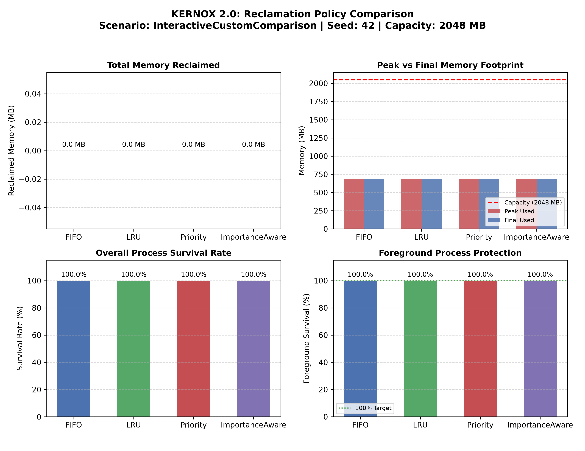
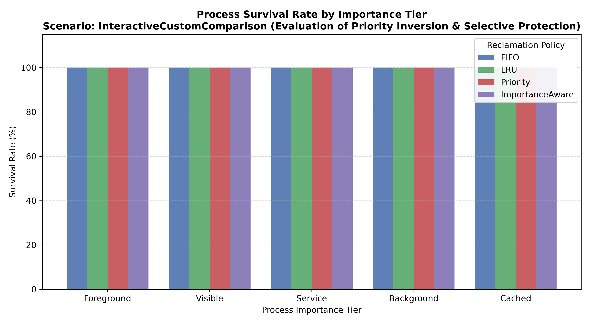
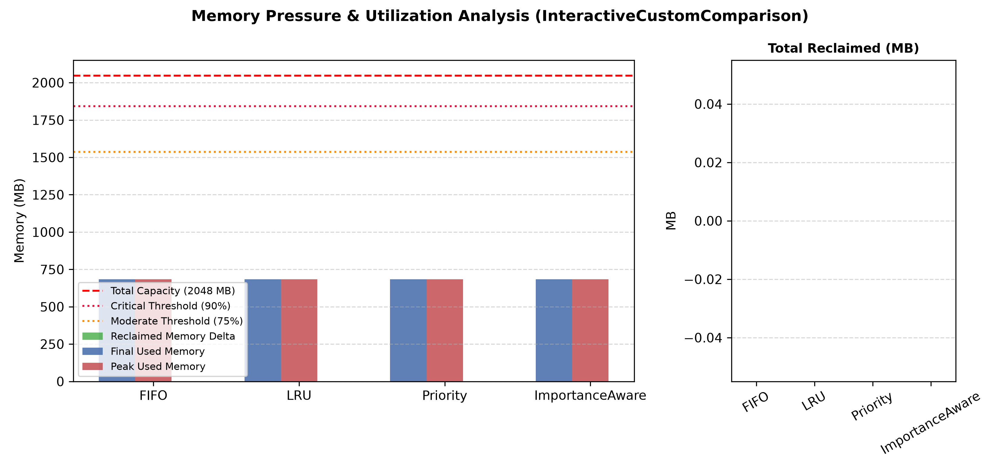
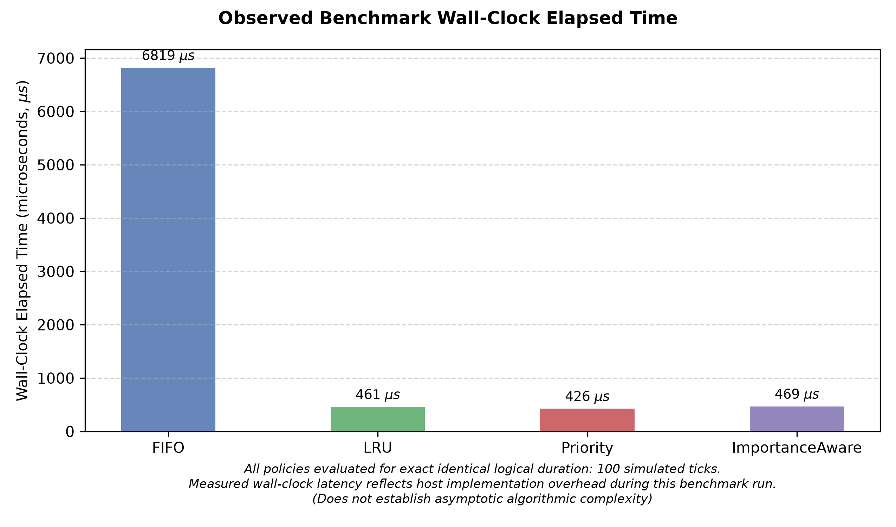

# KERNOX 2.0 — Experiment Analytical Report
## Scenario: InteractiveCustomComparison (Seed: 42)

### 1. Data Provenance & Experiment Metadata

| Parameter | Value |
|---|---|
| **Data Domain** | `kernox_simulation` |
| **Scenario Name** | `InteractiveCustomComparison` |
| **Random Seed** | `42` |
| **Workload Fingerprint** | `WKL-579105D8B54099EE` |
| **Total Memory Capacity** | 2048 MB (2147483648 bytes) |
| **Active Policies Evaluated** | FIFO, LRU, Priority, ImportanceAware |

### 2. Reclamation Policy Comparison Summary

| Policy | Reclaimed (MB) | Survival Rate (%) | FG Survival (%) | Peak Used (MB) | Final Used (MB) | Wall-Clock Time (μs) |
|---|:---:|:---:|:---:|:---:|:---:|:---:|
| **FIFO** | 0.0 MB | 100.0% | 100.0% | 684.0 MB | 684.0 MB | 6819 μs |
| **LRU** | 0.0 MB | 100.0% | 100.0% | 684.0 MB | 684.0 MB | 461 μs |
| **Priority** | 0.0 MB | 100.0% | 100.0% | 684.0 MB | 684.0 MB | 426 μs |
| **ImportanceAware** | 0.0 MB | 100.0% | 100.0% | 684.0 MB | 684.0 MB | 469 μs |

### 3. Process Survival by Importance Tier

| Policy | Foreground | Visible | Service | Background | Cached |
|---|:---:|:---:|:---:|:---:|:---:|
| **FIFO** | 100.0% | 100.0% | 100.0% | 100.0% | 100.0% |
| **LRU** | 100.0% | 100.0% | 100.0% | 100.0% | 100.0% |
| **Priority** | 100.0% | 100.0% | 100.0% | 100.0% | 100.0% |
| **ImportanceAware** | 100.0% | 100.0% | 100.0% | 100.0% | 100.0% |

### 4. Key Analytical Insights

- ImportanceAware satisfied its configured protection guarantee, preserving 100% of foreground processes during reclamation.
- ImportanceAware prioritized lower importance tiers for eviction (observed cached process survival: 100.0%).
- Consistent with its arrival-order design without tier awareness, FIFO evicted oldest processes regardless of importance (observed foreground survival: 100.0%).
- Consistent with its recency-order design without tier awareness, LRU evicted least recently active processes regardless of importance (observed foreground survival: 100.0%).
- Priority evicted processes based strictly on CPU scheduling urgency (observed foreground survival: 100.0%).
- Workload did not breach memory pressure thresholds; no processes were reclaimed across any evaluated policy.

### 5. Policy Rankings

- **Overall Process Survival:** FIFO = LRU = Priority = ImportanceAware (100.0% - Tied)
- **Foreground Protection:** ImportanceAware = Priority = LRU = FIFO (100.0% - Tied)
- **Memory Reclaimed:** FIFO = LRU = ImportanceAware = Priority (0.0 MB - Tied)
- **Execution Speed (Wall-Clock):** Single-run host latency observations, not an algorithmic performance ranking:
  - FIFO: 6819 μs
  - LRU: 461 μs
  - Priority: 426 μs
  - ImportanceAware: 469 μs
  *The first policy execution recorded substantially higher host latency. Cold-start or initialization overhead may have contributed, but this single measurement cannot establish the cause.*

### 6. Visualizations

#### Policy Comparison

#### Process Survival Breakdown

#### Memory Pressure Analysis

#### Execution Performance

### 7. Scientific Limitations & Boundaries

1. **Synthetic Deterministic Workload**: Results reflect the synthetic workload generator for this specific scenario and seed. They do not constitute a universal benchmark across arbitrary application behaviors.
2. **Simulation vs Production Kernel**: Memory pressure detection and process reclamation run in a deterministic C++ simulation model. Real Linux/Android kernels include kernel-level slab reclamation, swap compaction, and zRAM dynamics that are abstracted here.
3. **Non-Causal Observations**: Rankings indicate relative performance within this evaluation harness and do not imply universal algorithm superiority.
4. **Observed Latency vs Asymptotic Complexity**: Measured wall-clock execution time reflects a single-run host observation under this specific workload and environment. The first policy execution recorded substantially higher host latency. Cold-start or initialization overhead may have contributed, but this single measurement cannot establish the cause. The benchmark harness does not perform multi-iteration statistical sampling, and single-run host measurements must not be interpreted as algorithmic performance rankings or asymptotic complexity proofs.
5. **Configured Protection Guarantees**: Only ImportanceAware is architecturally configured with a foreground protection guarantee. Arrival-order (FIFO) and recency-order (LRU) policies do not promise tier immunity, and their eviction of foreground processes reflects their algorithmic design rather than an invariant violation.

---
*Report generated automatically by KERNOX 2.0 Analytics Layer.*
