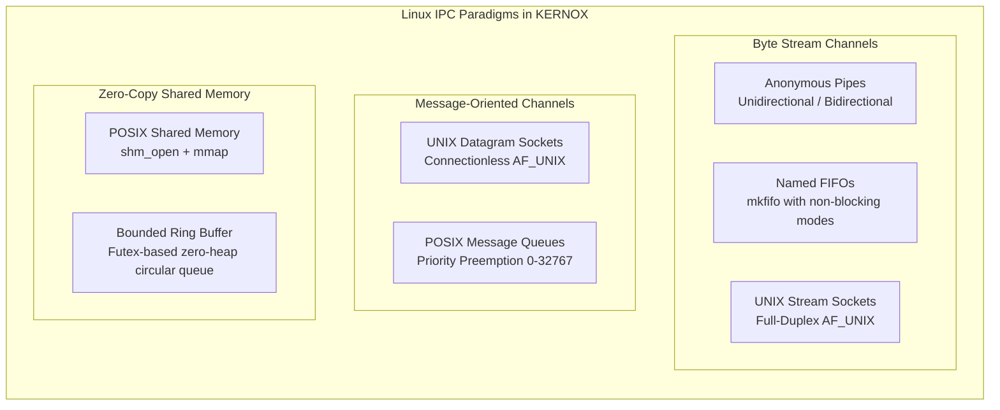
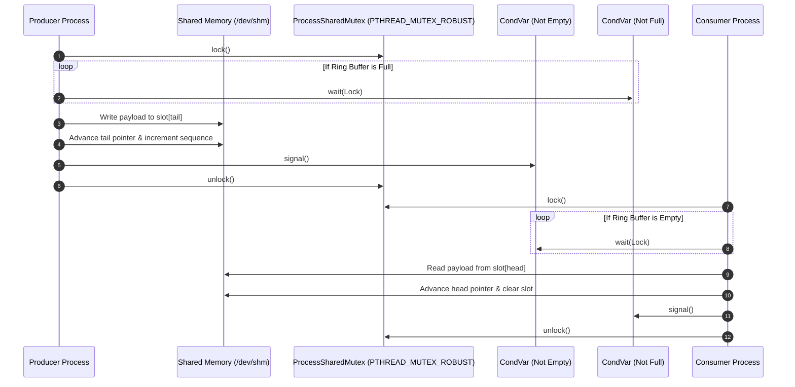

# KERNOX System Architecture & Design Specification

**Project:** KERNOX — A Comprehensive Operating Systems Simulation and Linux Systems Programming Platform
**Target Environment:** Linux / POSIX (Ubuntu 24.04 LTS on WSL 2 / Native Linux x86_64)
**Language Standard:** Modern C++20 (`-std=c++20`)
**Design Paradigm:** Type-Safe Functional Monadic Error Handling, Strict RAII Ownership, Zero-Heap Shared Memory Layouts

---

## 1. High-Level System Architecture

KERNOX is designed around the architectural principle of **Zero-Falsehood Duality**: separating theoretical operating system simulations from genuine Linux kernel system programming while providing a unified presentation and execution environment.

```mermaid
graph TD
    subgraph UI_Layer [CLI & Presentation Layer]
        CLI[CommandDispatcher]
        TableFmt[ASCII Table Formatters]
        GanttFmt[Gantt Chart Engine]
    end

    subgraph Sim_Layer [Algorithmic Simulation Subsystem - kernox_sim]
        CpuSim[CPU Scheduling Simulator<br/>FCFS, SJF, SRTF, RR, Priority, MLFQ]
        DiskSim[Disk Head Simulator<br/>FCFS, SSTF, SCAN, C-SCAN, LOOK, C-LOOK]
        DeadlockSim[Deadlock Management Engine<br/>Banker's, Request Rollback, RAG Cycles]
        MemSim[Memory & Virtual Memory Engine<br/>Fits, Coalescing, MMU Paging, LRU, Working Set]
    end

    subgraph System_Layer [Real Linux POSIX Systems Layer - kernox_system]
        ProcMgr[ProcessManager & Sandboxing<br/>fork, execve, wait4, setrlimit, rusage]
        Telemetry[System & Process Telemetry<br/>/proc/stat, meminfo, status, io]
        PipeFifo[Pipes & Named FIFOs<br/>pipe, mkfifo, PIPE_BUF validation]
        Shm[POSIX Shared Memory<br/>shm_open, ftruncate, mmap, munmap, shm_unlink]
        SyncSub[Process-Shared Concurrency<br/>ProcessSharedMutex, PosixSemaphore, CondVar]
        RingBuf[Shared-Memory Ring Buffer<br/>Zero-heap bounded queue, sequence tracking]
        UnixSock[UNIX Domain Sockets<br/>Stream, Dgram, SO_PEERCRED, SCM_RIGHTS]
        MsgQueue[POSIX Message Queues<br/>mq_open, priority preemption, timeouts]
    end

    subgraph Core_Layer [Core Foundations & RAII Utilities - kernox_core]
        ResultMonad[Result&lt;T, Error&gt; Functional Monad]
        UniqueFd[UniqueFd RAII Descriptor Guard]
        ChildProc[ChildProcess RAII Lifecycle Guard]
        SteadyTimer[High-Resolution Monotonic Timer]
        Logger[Thread-Safe Structured Logger]
    end

    subgraph Kernel_Boundary [Linux Kernel & POSIX VFS]
        KernelProc[/proc Virtual Filesystem]
        KernelShm[/dev/shm Shared Memory]
        KernelMq[/dev/mqueue Message Queues]
        KernelFutex[Futex & Signal Escalation]
        KernelSocket[AF_UNIX Socket VFS Nodes]
    end

    CLI --> Sim_Layer
    CLI --> System_Layer
    Sim_Layer --> Core_Layer
    System_Layer --> Core_Layer
    System_Layer --> Kernel_Boundary
```

---

## 2. Module Boundaries & Core Abstractions

### 2.1 Core Layer (`kernox_core`)
- **`Result<T, Error>`:** Functional monadic error container replacing exceptions (`std::expected` equivalent in C++20). Forces callers to explicitly handle errors via `.is_ok()`, `.value()`, and `.error()`.
- **`UniqueFd`:** Move-only RAII container for native POSIX integer file descriptors. Enforces automatic closing (`::close`) upon destruction and prevents descriptor leaks.
- **`ChildProcess`:** Move-only RAII handle for spawned processes. Guards against zombie processes by ensuring children are reaped via non-blocking or timed `waitpid` upon destruction.
- **`Timer`:** Nanosecond-resolution monotonic stopwatch backed by `std::chrono::steady_clock`.

### 2.2 Simulation Engine (`kernox_sim`)
- Pure discrete-event mathematical engines with zero host side effects.
- 100% deterministic, reproducible across any architecture or host OS.
- Tracks exact metrics (Waiting Time, Turnaround Time, Total Head Movement, Page Fault Counts).

### 2.3 Real Systems Layer (`kernox_system`)
- Interacts directly with Linux kernel VFS, process tables, virtual memory mappings, and IPC channels.
- Encapsulates error code translations from POSIX `errno` to typed `core::ErrorCode`.

---

## 3. Process Management Lifecycle Architecture

KERNOX implements a robust process spawning and supervision pipeline with progressive signal escalation:

```mermaid
sequenceDiagram
    autonumber
    actor User as Parent Process (ProcessManager)
    participant Pipe as Error Pipe
    participant Child as Child Process (forked)
    participant Kernel as Linux Kernel

    User->>Pipe: pipe2(O_CLOEXEC)
    User->>Child: fork()
    alt Child Context (pid == 0)
        Child->>Kernel: setrlimit(RLIMIT_CPU, RLIMIT_AS, etc.)
        Child->>Kernel: execv() / execve()
        Note over Child,Kernel: If exec succeeds, O_CLOEXEC closes pipe
        alt If exec fails
            Child->>Pipe: write(errno)
            Child->>Kernel: _exit(127)
        end
    else Parent Context (pid > 0)
        User->>Pipe: read(errno)
        alt Error pipe closed without data
            Note over User: Execution succeeded
        else Error data received
            Note over User: Spawning failed; extract error
        end
        loop Supervisor Loop (Timeout Monitoring)
            User->>Kernel: waitpid(pid, WNOHANG)
            alt Process exits normally
                User->>Kernel: wait4(pid, rusage)
                Note over User: Collect CPU & memory rusage
            else Timeout Exceeded
                User->>Kernel: kill(pid, SIGTERM)
                Note over User: Wait grace period (200ms)
                alt Still running after grace
                    User->>Kernel: kill(pid, SIGKILL)
                    User->>Kernel: waitpid(pid, 0)
                end
            end
        end
    end
```

---

## 4. Inter-Process Communication (IPC) Architecture

KERNOX provides comprehensive implementations and benchmarks for all five POSIX IPC paradigms:



### IPC Capabilities Matrix:
| IPC Mechanism | Transport Paradigm | Protocol Boundary | Kernel Resource | Zero-Copy? |
| :--- | :--- | :--- | :--- | :---: |
| **Anonymous Pipe** | Byte Stream | Unidirectional / Pair | File Descriptor Table | No |
| **Named FIFO** | Byte Stream | Half-Duplex Channel | Filesystem Node (`mkfifo`) | No |
| **UNIX Stream Socket** | Byte Stream | Full-Duplex Connection | VFS Socket (`AF_UNIX`) | No |
| **UNIX Datagram Socket**| Datagram Packet | Connectionless / Pair | VFS Socket (`AF_UNIX`) | No |
| **POSIX Message Queue** | Prioritized Messages| Discrete Messages | Kernel VFS (`/dev/mqueue`) | No |
| **POSIX Shared Memory** | Raw Memory Region | Cross-Process Mappings| Kernel VFS (`/dev/shm`) | **Yes** |

---

## 5. Shared-Memory Ring Buffer & Synchronization Workflow

The `SharedRingBuffer` coordinates high-throughput producer-consumer communication directly in `/dev/shm` without dynamic heap allocations:



### Mutex Robustness (`PTHREAD_MUTEX_ROBUST`):
If the Producer process is killed with `SIGKILL` while holding `Lock`:
1. The Linux kernel detects the dead owner and unblocks waiting processes.
2. `Consumer` receives return value `EOWNERDEAD` from `pthread_mutex_lock`.
3. `ProcessSharedMutex` marks the lock state as `InconsistentRecovered`.
4. Consumer invokes `pthread_mutex_consistent()`, restores shared memory invariants, and proceeds safely without deadlocking.

---

## 6. Error Handling & Resource Management Strategy

1. **Zero-Exception Policy in Systems Modules:**
   - Exception throwing is prohibited in low-level systems modules to prevent stack unwinding anomalies across `fork()` boundaries.
   - All operations return `core::Result<T, core::Error>`.
2. **Move-Only RAII Lifecycle:**
   - Move semantics ensure strict single-ownership of descriptors, sockets, processes, and memory regions.
   - Destructors are unconditionally `noexcept` and guarantee deterministic cleanup of kernel objects.
3. **Owner-PID Cleanups:**
   - Named objects (`/dev/shm/*`, `/dev/mqueue/*`, `/tmp/*.sock`) track the PID that created them (`owner_pid_`).
   - Only the originating process invokes `shm_unlink`, `mq_unlink`, or `unlink` upon termination, ensuring child workers do not inadvertently destroy shared objects.
