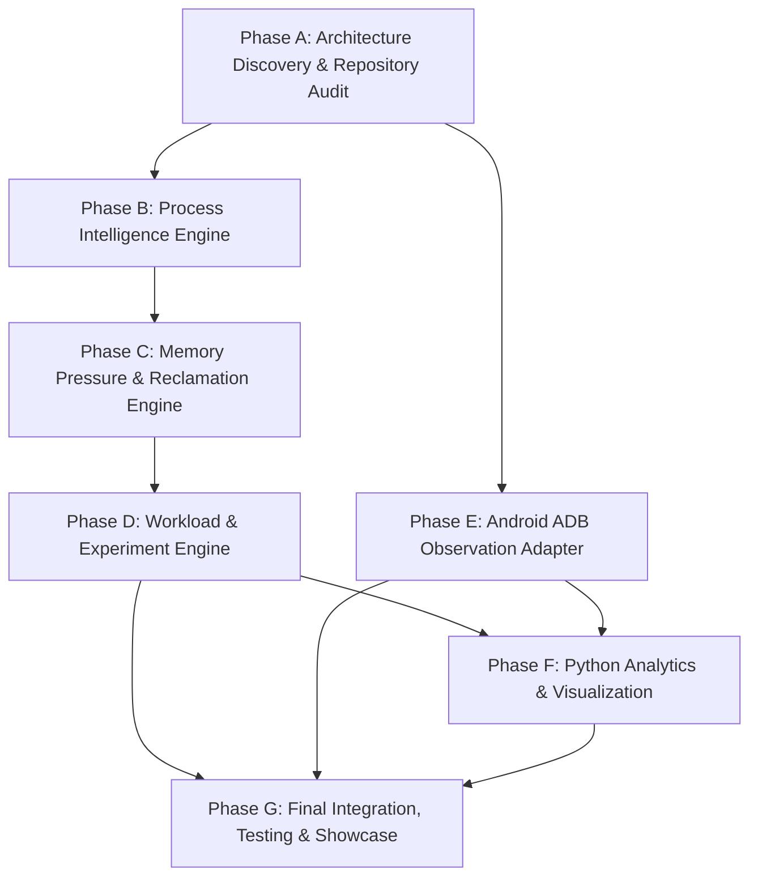

# KERNOX 2.0: Phased Implementation Roadmap

**Project:** KERNOX 2.0 — Android & Linux Resource Intelligence Platform
**Target Environment:** Ubuntu 24.04 LTS on WSL2 / Native Linux x86_64
**Compiler:** GCC 13.3.0+ / Clang 16+ (`-std=c++20`)
**Status:** Phases A, B, C, D, E, F Complete (Ready for Phase G: Final Integration & Showcase)

---

## 1. Roadmap Overview & Dependency Graph

KERNOX 2.0 implementation is structured into seven sequential phases (Phases A through G). Each phase establishes clear preconditions, defines concrete file deliverables, implements rigorous unit tests, and validates acceptance criteria before progressing to the subsequent phase.

---

## 2. Phase-by-Phase Implementation Specifications

### Phase A: Architecture Discovery & Repository Audit (CURRENT PHASE)
- **Status:** **COMPLETE**
- **Objectives:**
  1. Audit complete KERNOX 1.0 repository structure, CMake configurations, test suites, and documentation.
  2. Evaluate existing CPU scheduling, memory management, process supervision, and telemetry interfaces.
  3. Formulate the KERNOX 2.0 architecture, component boundaries, and data flows.
  4. Author foundational architecture, roadmap, and mapping documentation without altering existing source code.
- **Files Created:**
  - `docs/KERNOX_2_UPGRADE_ARCHITECTURE.md`
  - `docs/KERNOX_2_IMPLEMENTATION_ROADMAP.md`
  - `docs/KERNOX_2_EXISTING_MODULE_MAPPING.md`
- **Dependencies:** None.
- **Acceptance Criteria:**
  - 100% of existing repository files preserved.
  - Zero modifications to existing source, header, test, or build files.
  - No commits or pushes performed.
- **Potential Risks:** Premature implementation before architecture alignment. (Mitigated by strict inspection-only protocol).

---

### Phase B: Process Intelligence Engine
- **Objectives:**
  1. Implement the comprehensive process descriptor model (`SimulatedProcess`) decoupling CPU scheduling priority from mobile importance.
  2. Implement the process lifecycle state machine (Created -> Ready -> Running -> Blocked -> Completed / Terminated).
  3. Implement importance categorization (Foreground, Visible, Service, Background, Cached).
  4. Provide helper conversion adapters to project `SimulatedProcess` into existing `sim::ProcessTask`.
- **Files Expected to be Created/Extended:**
  - `include/kernox/modules/intel/process_model.hpp` (New Header)
  - `src/modules/intel/process_model.cpp` (New Source)
  - `tests/test_process_intel.cpp` (New Automated CTest Suite)
  - `CMakeLists.txt` (Register `kernox_intel` library target)
- **Dependencies:** Phase A, `kernox_core` (`Result<T, Error>`).
- **Implementation Tasks:**
  - Define `ProcessLifecycleState`, `ProcessImportance`, and `ProcessResourceFootprint` enums/structs.
  - Implement state transition validators preventing illegal transitions (e.g. `Terminated` -> `Running`).
  - Implement `.to_task()` projection method for CPU scheduling integration.
  - Implement string formatters for process descriptors and state traces.
- **Testing & Quality Assurance:**
  - Unit test `test_process_intel`: 100% coverage of lifecycle transitions, invalid transition rejections, importance assignments, and metric tracking.
- **Acceptance Criteria:**
  - CPU priority (0–99) and importance (100–500) remain strictly separated.
  - All unit tests pass with zero warnings under `-Werror`.
- **Potential Risks:** Accidental coupling of mobile importance with CPU nice values. (Mitigated by independent strong types).

---

### Phase C: Memory Pressure & Reclamation Engine
- **Objectives:**
  1. Implement `MemoryPressureDetector` to monitor aggregate memory consumption against configurable thresholds.
  2. Implement the abstract strategy interface `IReclamationPolicy`.
  3. Implement four concrete reclamation policies: FIFO, LRU, Priority-based, and Android-inspired Importance-Aware.
  4. Implement `MemoryReclamationEngine` orchestrating victim selection and process termination.
- **Files Expected to be Created/Extended:**
  - `include/kernox/modules/reclaim/pressure_detector.hpp` (New Header)
  - `include/kernox/modules/reclaim/reclamation_policy.hpp` (New Header)
  - `include/kernox/modules/reclaim/reclamation_engine.hpp` (New Header)
  - `src/modules/reclaim/pressure_detector.cpp` (New Source)
  - `src/modules/reclaim/reclamation_policy.cpp` (New Source)
  - `src/modules/reclaim/reclamation_engine.cpp` (New Source)
  - `tests/test_reclamation.cpp` (New Automated CTest Suite)
  - `CMakeLists.txt` (Register `kernox_reclaim` library target)
- **Dependencies:** Phase B, `kernox_intel`, `kernox_core`.
- **Implementation Tasks:**
  - Implement threshold logic computing `Normal`, `Moderate`, and `Critical` pressure transitions.
  - Implement `FifoReclamationPolicy` (terminates oldest processes by creation timestamp).
  - Implement `LruReclamationPolicy` (terminates processes unreferenced longest).
  - Implement `PriorityReclamationPolicy` (terminates processes with lowest CPU priority).
  - Implement `ImportanceAwareReclamationPolicy` (shields Foreground/Visible; reclaims Cached -> Background -> Service).
  - Implement `ReclamationReport` generating detailed summaries of reclaimed bytes and victim decisions.
- **Testing & Quality Assurance:**
  - Unit test `test_reclamation`: Assert exact victim selection orders across all four policies under identical memory shortfall inputs.
- **Acceptance Criteria:**
  - Importance-aware policy guarantees Foreground processes are never reclaimed when Cached or Background tasks exist.
  - Zero memory leaks under AddressSanitizer.
- **Potential Risks:** Endless reclamation loops if pool is exhausted. (Mitigated by aborting when no terminable victims remain).

---

### Phase D: Workload & Experiment Engine
- **Objectives:**
  1. Implement a deterministic pseudo-random workload generator backed by `std::mt19937_64`.
  2. Implement standard benchmark scenarios: Normal, High Pressure, Background Heavy, Foreground Protection, and Mixed.
  3. Implement `ExperimentRunner` executing side-by-side policy comparisons using identical random seeds.
  4. Provide JSON and CSV serialization for experiment results.
- **Files Expected to be Created/Extended:**
  - `include/kernox/modules/experiment/workload_generator.hpp` (New Header)
  - `include/kernox/modules/experiment/experiment_runner.hpp` (New Header)
  - `src/modules/experiment/workload_generator.cpp` (New Source)
  - `src/modules/experiment/experiment_runner.cpp` (New Source)
  - `tests/test_experiment.cpp` (New Automated CTest Suite)
  - `CMakeLists.txt` (Register `kernox_experiment` library target)
- **Dependencies:** Phase B, Phase C, `kernox_core`.
- **Implementation Tasks:**
  - Implement seedable PRNG generating repeatable task arrivals, burst lengths, and memory footprints.
  - Implement scenario builders generating specific distribution profiles.
  - Implement side-by-side comparative harness executing FIFO, LRU, Priority, and Importance-Aware policies on identical task sequences.
  - Implement JSON/CSV serializing formatters for all metrics and traces.
- **Testing & Quality Assurance:**
  - Unit test `test_experiment`: Verify identical output vectors across repeated runs with identical seeds.
- **Acceptance Criteria:**
  - Comparative benchmark produces empirical proof of importance-aware superiority in foreground task survival.
- **Potential Risks:** Non-deterministic timing leaks from host steady clock. (Mitigated by driving experiments via discrete simulation ticks).

---

### Phase E: Android ADB Observation Adapter
- **Status:** **COMPLETE**
- **Objectives:**
  1. Implement `AdbBridge` to execute non-destructive host `adb` commands (`adb devices`, `adb shell dumpsys meminfo`).
  2. Implement robust string token parsers for Android memory metrics and process tables.
  3. Ensure complete graceful fallback when ADB is not installed or no device is connected.
  4. Keep device observation strictly separate from the user-space simulation engine.
- **Files Created/Extended:**
  - `include/kernox/modules/adb/types.hpp`, `bridge.hpp`, `parser.hpp`, `service.hpp`
  - `src/modules/adb/types.cpp`, `bridge.cpp`, `parser.cpp`, `service.cpp`
  - `tests/test_adb_parser.cpp` (Automated CTest Suite with 12 static fixtures in `tests/fixtures/adb/`)
  - `CMakeLists.txt` (Registered `kernox_adb` target)
  - `docs/KERNOX_2_PHASE_E_ANDROID_ADB.md`
- **Dependencies:** Phase A, `kernox_core`.
- **Testing & Quality Assurance:**
  - 100% pass across all 20 CTest suites on `dev-debug`, `dev-release`, `dev-asan`.
- **Acceptance Criteria Met:**
  - Zero dependencies on real hardware for automated CI/CTest runs.
  - Clean error messages when no physical device is detected.

---

### Phase F: Python Analytics & Visualization
- **Status:** **COMPLETE**
- **Objectives:**
  1. Implement an isolated Python analytics and visualization package (`kernox_analytics`) consuming Phase D experiment exports and Phase E Android snapshots.
  2. Implement schema validation, data cleaning, mathematical metric derivations, and statistical aggregation.
  3. Generate publication-quality Matplotlib visualizations: policy comparison, tier survival, memory pressure thresholds, cross-scenario evaluation, execution latency, and Android device/process memory distributions.
  4. Provide an automated Markdown report generation tool with embedded figure links.
- **Files Created:**
  - `tools/analytics/requirements.txt`
  - `tools/analytics/README.md`
  - `tools/analytics/config/analytics_config.json`
  - `tools/analytics/src/kernox_analytics/`: `__init__.py`, `loader.py`, `validators.py`, `metrics.py`, `statistics.py`, `experiment_analysis.py`, `android_analysis.py`, `visualizations.py`, `report_generator.py`, `cli.py`
  - `tools/analytics/tests/`: `test_loader.py`, `test_validators.py`, `test_metrics.py`, `test_experiment_analysis.py`, `test_android_analysis.py` (30 unit tests)
  - `tools/analytics/examples/`: Authoritative C++ generated experiment and Android samples
  - `docs/KERNOX_2_PHASE_F_PYTHON_ANALYTICS.md`
- **Dependencies:** Phase D, Phase E.
- **Testing & Quality Assurance:**
  - 30 / 30 pytest tests passed (100% pass rate).
  - All 20 existing C++ CTest suites verified across `dev-debug`, `dev-release`, `dev-asan`.
- **Acceptance Criteria Met:**
  - C++ build has zero build-time dependency on Python.
  - Strict data provenance domain isolation (`kernox_simulation` vs `android_adb_observation`).
  - Python CLI (`python -m kernox_analytics.cli`) functions cleanly with all subcommands.

---

### Phase G: Final Integration, Testing & Showcase
- **Objectives:**
  1. Integrate all new modules into the unified `kernox` CLI (`kernox intel`, `kernox reclaim`, `kernox experiment`, `kernox adb`).
  2. Verify complete multi-preset test matrix: Debug, Release, and AddressSanitizer/UndefinedBehaviorSanitizer.
  3. Update root `README.md`, `docs/CLI_REFERENCE.md`, and author `docs/KERNOX_2_DEMO_GUIDE.md`.
  4. Perform end-to-end verification of all CLI demo commands.
- **Files Expected to be Created/Extended:**
  - `src/cli/command.cpp` (Register new subcommands)
  - `include/kernox/cli/command.hpp`
  - `tests/CMakeLists.txt` (Ensure all 20+ CTest targets are registered)
  - `scripts/test.sh` (Update with KERNOX 2.0 smoke verification)
  - `docs/CLI_REFERENCE.md` (Document new subcommands)
  - `docs/KERNOX_2_DEMO_GUIDE.md` (Step-by-step viva presentation script)
- **Dependencies:** Phases B, C, D, E, F.
- **Acceptance Criteria:**
  - 100% test pass rate across all existing (16) and new (5+) CTest suites.
  - Zero compiler warnings under strict `-Werror` flags.
  - Complete viva demonstration runnable in under 15 minutes.
- **Potential Risks:** Scope creep during CLI wiring. (Mitigated by strict command schema design).
