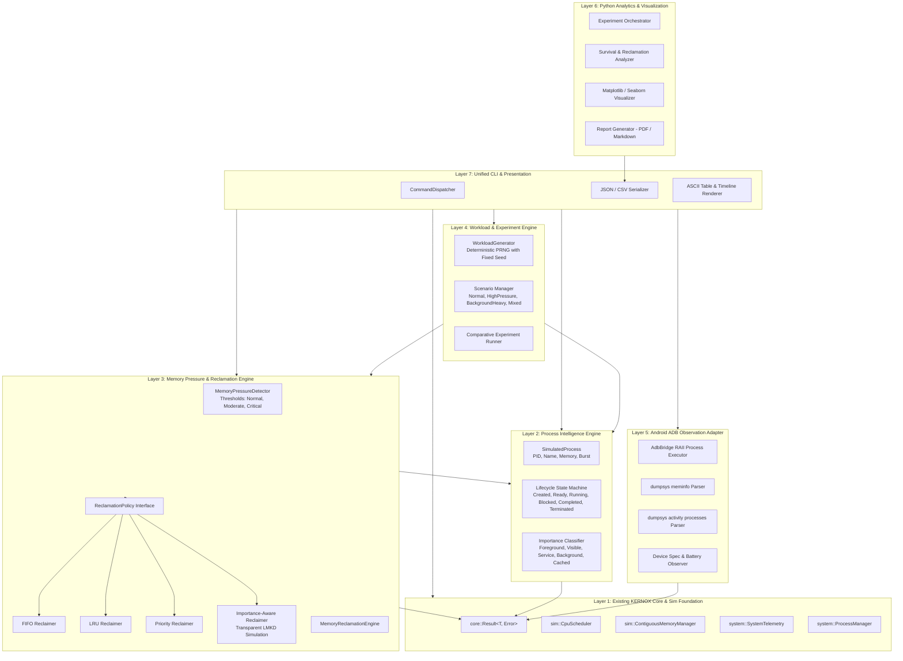

# KERNOX 2.0: Android & Linux Resource Intelligence Platform
## System Architecture & Technical Upgrade Blueprint

**Project:** KERNOX 2.0 — Android & Linux Resource Intelligence Platform
**Previous Baseline:** KERNOX 1.0 (Phase 5 Final Release, Commit `d5c0f88`)
**Standard:** Modern C++20 (`-std=c++20`) | Target: Linux / POSIX (WSL2 / Ubuntu 24.04 LTS)
**Author:** Senior C++ Systems Engineer, Operating Systems Architect, and Software Engineering Reviewer
**Status:** Phase 1 Architecture Blueprint (Planning & Audit Only — Implementation Deferred)

---

## 1. Executive Summary & Project Vision

KERNOX 1.0 established a rigorous dual-pillar architecture: a pure, deterministic user-space Operating Systems Simulation Engine (`kernox_sim`) alongside an industrial-grade Linux POSIX Systems Programming Layer (`kernox_system`). Across Phases 1 through 5, KERNOX validated textbook algorithmic models (CPU, disk, deadlock, memory) and implemented native Linux kernel facilities (`fork`, `execve`, `wait4`, `setrlimit`, `shm_open`, `mmap`, `futex`, `AF_UNIX`, `mq_*`, and `/proc` telemetry) with 16 automated CTest suites passing 100% under strict compiler flags (`-Werror`) and AddressSanitizer.

**KERNOX 2.0** extends this foundation into a cutting-edge **Android & Linux Resource Intelligence Platform**. While classic desktop and server operating systems manage memory through swap partitions and demand paging, mobile and modern embedded Linux operating systems (predominantly Android) operate under severe memory constraints without traditional swap. Instead, they employ active **memory pressure detection**, **process importance hierarchies**, and **low-memory reclamation algorithms** that proactively terminate background tasks to preserve foreground responsiveness.

KERNOX 2.0 models and analyzes these real-world mobile and embedded resource management paradigms while maintaining strict architectural hygiene:
1. **Process Intelligence Engine:** Decouples CPU execution priority from Android-inspired process lifecycle importance (Foreground, Visible, Service, Background, Cached).
2. **Memory Pressure & Reclamation Engine:** Simulates progressive memory exhaustion, detects threshold-based pressure tiers (Normal, Moderate, Critical), and executes comparative reclamation policies (FIFO, LRU, Priority-based, and Importance-aware).
3. **Reproducible Experiment Engine:** Generates deterministic synthetic and trace-driven workloads with identical random seeds for fair cross-policy benchmarking.
4. **Android ADB Observation Adapter:** Connects to physical or emulated Android devices via the Android Debug Bridge (`adb`) to gather live real-device telemetry without conflating live observations with user-space simulations.
5. **Python Analytics & Visualization Pipeline:** Consumes structured JSON/CSV telemetry exports from the C++ engine to compute survival rates, memory recovery efficiency, and comparative performance plots.

---

## 2. Existing Architecture Assessment (KERNOX 1.0)

### 2.1 Current Strengths
- **Modular Library Decoupling:** CMake cleanly segments functionality into `kernox_core` (RAII primitives), `kernox_sim` (algorithmic models), `kernox_system` (real POSIX facilities), and `kernox_cli` (command dispatching).
- **Type-Safe Functional Monadic Error Handling:** `core::Result<T, Error>` completely eliminates exception-unwinding hazards across `fork()` boundaries.
- **Strict RAII Invariants:** Native file descriptors (`UniqueFd`), child processes (`ChildProcess`), shared memory (`SharedMemory`), and message queues (`PosixMessageQueue`) are move-only and leak-free.
- **High-Resolution Telemetry:** Direct parsing of `/proc/stat`, `/proc/meminfo`, `/proc/loadavg`, `/proc/<pid>/status`, and `/proc/<pid>/io` provides empirical systems grounding.

### 2.2 Architectural Gaps for KERNOX 2.0
- **Process Model Simplicity:** The existing `sim::ProcessTask` only tracks `pid`, `arrival_time`, `burst_time`, and `priority`. It lacks memory footprints, lifecycle states, process names, and importance classifications.
- **Memory Model Disconnect:** Existing memory simulation (`sim::ContiguousMemoryManager` and `sim::PagingSystem`) simulates contiguous partition fitting and virtual memory frame replacement for a single stream of references. It does not model global system-wide memory exhaustion, process kill hierarchies, or memory reclamation under memory pressure.
- **Absence of Real-Time Device Observation:** Current telemetry is restricted to local host `/proc` files. There is no adapter to inspect remote mobile or embedded systems (e.g. Android devices via ADB).
- **Monolithic Terminal Output:** Metrics and traces are currently printed as ASCII tables to `std::cout`. There is no automated structured JSON/CSV export pipeline to drive external data science and analytics tools.

---

## 3. KERNOX 2.0 System Architecture

The upgraded architecture preserves the existing KERNOX layers intact and introduces dedicated, loosely coupled modules for mobile resource intelligence:



---

## 4. Module-by-Module Technical Specification

### 4.1 Layer 2: Process Intelligence Engine (`include/kernox/modules/intel/`)

#### Responsibilities:
Models advanced process descriptors that decouple CPU execution priority from mobile lifecycle importance.

#### Core Enums and Data Structures:
```cpp
namespace kernox::intel {

// Lifecycle State (Active Execution Status)
enum class ProcessLifecycleState : uint32_t {
    Created = 0,
    Ready,
    Running,
    Blocked,
    Completed,
    Terminated
};

// Android-Inspired Importance Classification
// Higher numeric score indicates lower importance (more eligible for termination).
enum class ProcessImportance : uint32_t {
    Foreground = 100,  // Active user interaction (Top Activity / Input receiver)
    Visible    = 200,  // Visible to user but not focused (e.g. paused behind dialog)
    Service    = 300,  // Background processing with user awareness (music playback)
    Background = 400,  // Invisible background activity
    Cached     = 500   // Idle, retained in memory for instant relaunch
};

struct ProcessResourceFootprint {
    uint64_t memory_requirement_bytes{0}; // Declared total capacity required
    uint64_t memory_consumed_bytes{0};    // Current resident memory consumption
    uint64_t peak_memory_bytes{0};        // High-water mark of allocation
};

struct SimulatedProcess {
    uint32_t pid{0};
    std::string name{};
    ProcessLifecycleState state{ProcessLifecycleState::Created};

    // CPU Execution Properties
    uint32_t cpu_priority{0};            // 0 = highest CPU scheduling priority
    uint64_t cpu_burst_remaining{0};     // Simulated ticks needed to complete
    uint64_t cpu_time_executed{0};       // Simulated ticks consumed so far

    // Mobile / Memory Management Properties
    ProcessImportance importance{ProcessImportance::Cached};
    ProcessResourceFootprint memory{};

    // Monotonic Timeline Tracking
    uint64_t creation_time_ticks{0};
    uint64_t last_active_time_ticks{0};  // Used for LRU reclamation decisions
    uint64_t completion_time_ticks{0};
    bool was_killed_under_pressure{false};
};

} // namespace kernox::intel
```

#### Invariant Protection:
- `cpu_priority` and `importance` are isolated in distinct member fields and enums. CPU schedulers evaluate `cpu_priority`; memory pressure reclaimers evaluate `importance`.

---

### 4.2 Layer 3: Memory Pressure and Reclamation Engine (`include/kernox/modules/reclaim/`)

#### Responsibilities:
Tracks aggregate physical memory utilization, detects system pressure transitions, and applies pluggable reclamation policies to preserve critical processes.

#### Core Interfaces and Data Structures:
```cpp
namespace kernox::reclaim {

enum class MemoryPressureLevel : uint32_t {
    Normal   = 0, // Memory usage < Moderate Threshold
    Moderate = 1, // Moderate Threshold <= Usage < Critical Threshold
    Critical = 2  // Usage >= Critical Threshold
};

struct PressureThresholds {
    uint64_t total_memory_bytes{1024 * 1024 * 1024}; // Default: 1 GB
    double moderate_threshold_ratio{0.75};           // 75% usage
    double critical_threshold_ratio{0.90};           // 90% usage

    [[nodiscard]] uint64_t moderate_limit_bytes() const noexcept {
        return static_cast<uint64_t>(total_memory_bytes * moderate_threshold_ratio);
    }
    [[nodiscard]] uint64_t critical_limit_bytes() const noexcept {
        return static_cast<uint64_t>(total_memory_bytes * critical_threshold_ratio);
    }
};

struct ReclamationDecision {
    uint32_t victim_pid{0};
    std::string victim_name{};
    intel::ProcessImportance importance{intel::ProcessImportance::Cached};
    uint64_t memory_reclaimed_bytes{0};
    std::string policy_reason{};
};

struct ReclamationReport {
    std::string policy_name{};
    MemoryPressureLevel initial_pressure{MemoryPressureLevel::Normal};
    MemoryPressureLevel final_pressure{MemoryPressureLevel::Normal};
    uint64_t initial_used_bytes{0};
    uint64_t final_used_bytes{0};
    uint64_t target_reclaim_bytes{0};
    uint64_t total_reclaimed_bytes{0};
    std::vector<ReclamationDecision> decisions;
    bool system_stabilized{false};
};

// Abstract Strategy Interface for Reclamation Policies
class IReclamationPolicy {
public:
    virtual ~IReclamationPolicy() = default;

    [[nodiscard]] virtual std::string_view policy_name() const noexcept = 0;

    // Selects and orders candidate victim processes for termination
    [[nodiscard]] virtual std::vector<uint32_t> select_victims(
        const std::vector<intel::SimulatedProcess>& process_pool,
        uint64_t bytes_to_reclaim) const = 0;
};

} // namespace kernox::reclaim
```

#### Planned Concrete Reclamation Policies:
1. **`FifoReclamationPolicy`:** Reclaims processes strictly ordered by `creation_time_ticks` (oldest process terminated first), oblivious to importance.
2. **`LruReclamationPolicy`:** Reclaims processes ordered by `last_active_time_ticks` (process unreferenced the longest terminated first).
3. **`PriorityReclamationPolicy`:** Reclaims processes ordered by CPU scheduling priority (lowest CPU priority processes terminated first).
4. **`ImportanceAwareReclamationPolicy`:** Our transparent Android-inspired simulation. Targets processes strictly ordered by `ProcessImportance`:
   $$\text{Cached (500)} \longrightarrow \text{Background (400)} \longrightarrow \text{Service (300)}$$
   Processes in `Foreground (100)` and `Visible (200)` are unconditionally shielded from termination unless memory exhaustion threatens total system failure.

---

### 4.3 Layer 4: Workload and Experiment Engine (`include/kernox/modules/experiment/`)

#### Responsibilities:
Provides reproducible, deterministic benchmark workloads and coordinates side-by-side policy comparisons.

#### Key Invariants & Repeatability:
- Employs a 64-bit Mersenne Twister engine (`std::mt19937_64`) initialized with an explicit random seed.
- When benchmarking policies (FIFO vs LRU vs Priority vs Importance-Aware), the experiment engine executes each policy against an **identical task generation sequence**, eliminating workload variation.

#### Standard Workload Scenarios:
1. **Normal Workload:** Balanced distribution of Foreground, Service, and Background tasks with manageable memory growth.
2. **High Memory Pressure:** Rapid burst of high-memory allocations forcing immediate entry into `Critical` pressure.
3. **Background-Heavy Workload:** Proliferation of idle background/cached tasks testing memory harvesting efficiency.
4. **Foreground Protection Stress:** Intense allocation bursts from background processes while critical foreground tasks are actively running.
5. **Mixed Workload:** Stochastic distribution of burst times, arrival intervals, and varying memory footprints.

---

### 4.4 Layer 5: Android ADB Observation Adapter (`include/kernox/modules/adb/`)

#### Responsibilities:
Gathers observational telemetry from connected Android devices (physical or emulated via Android Virtual Device / AVD).

#### Architectural Separation Boundaries:
```
+---------------------------------------------------------------------------------+
|                       KERNOX 2.0 ADB BOUNDARY ISOLATION                         |
+---------------------------------------+-----------------------------------------+
|     REAL ANDROID OBSERVATION          |       SIMULATED RECLAMATION ENGINE      |
|           (Layer 5 - ADB)             |         (Layers 2 & 3 - C++20)          |
+---------------------------------------+-----------------------------------------+
| - Invokes host `adb` binary           | - Pure C++20 state machines             |
| - Queries `dumpsys meminfo`           | - Models deterministic memory pressure  |
| - Queries `dumpsys activity proc`     | - Executes FIFO, LRU, LMKD simulations  |
| - Passive, observational telemetry    | - Evaluates process survival metrics    |
| - Non-destructive: does NOT kill      | - Deterministic, zero runtime jitter    |
| - Gracefully handles permission gaps  | - 100% reproducible on any OS platform  |
+---------------------------------------+-----------------------------------------+
```

#### Observation Data Models:
- `AdbDeviceInfo`: Model, Android OS Version, Build ID, Hardware Architecture.
- `AdbMemorySnapshot`: Total RAM, Free RAM, Used RAM, Lost RAM, ZRAM utilization from `dumpsys meminfo`.
- `AdbProcessSnapshot`: Top running processes, OOM adjustment values (`oom_adj` / `oom_score_adj`), and RSS memory footprints.

---

### 4.5 Layer 6: Python Analytics & Visualization Layer (`tools/analytics/`)

#### Responsibilities:
Provides post-experiment analytics, metric computation, and report generation using Python without coupling the C++ compiler toolchain to external Python libraries.

#### C++/Python Decoupling Contract:
The C++ CLI exports standard structured JSON:
```bash
./build/release/bin/kernox experiment run --scenario high-pressure --format json > experiment_results.json
```
The Python analytics tool consumes this JSON to produce:
1. **Survival Rate:** $\frac{\text{Processes Completed Normally}}{\text{Total Processes Spawned}} \times 100\%$
2. **Reclamation Efficiency:** $\frac{\text{Bytes Reclaimed}}{\text{Bytes Target}} \times 100\%$
3. **Important Task Protection Rate:** Survival percentage of Foreground and Visible tasks.
4. **Wasted CPU Time:** Aggregate CPU burst ticks consumed by processes that were subsequently killed before completion.
5. **Visual Charts:** Matplotlib line charts comparing memory reclamation curves over time across policies.

---

## 5. Important Engineering Decisions & Trade-Off Evaluations

| Architectural Question | Evaluated Options | Architectural Decision & Technical Rationale |
| :--- | :--- | :--- |
| **1. Memory Module Extension vs Separation?** | A. Overload `sim::ContiguousMemoryManager`<br/>B. Create dedicated `reclaim::MemoryReclamationEngine` | **Decision: Option B (Dedicated Engine).**<br/>`ContiguousMemoryManager` models contiguous fitting (First/Best/Worst Fit) and address fragmentation. Overloading it with mobile pressure tiers and process kill hierarchies would violate Single Responsibility and break existing Phase 3/5 tests. The new engine references memory capacities while leaving partition fitting untouched. |
| **2. Integrating New Process Model with Existing Management?** | A. Merge `SimulatedProcess` into `ProcessManager`<br/>B. Separate `SimulatedProcess` from native `ChildProcess` | **Decision: Option B (Explicit Separation).**<br/>`ChildProcess` and `ProcessManager` govern real Linux kernel processes (`fork`, `execve`, `wait4`). `intel::SimulatedProcess` is a discrete-event simulation model. Conflating simulated descriptors with OS PIDs would introduce severe bugs and violate the Zero-Falsehood principle. |
| **3. Reusing Existing CPU Scheduling Algorithms?** | A. Re-implement CPU schedulers<br/>B. Project `SimulatedProcess` into `ProcessTask` | **Decision: Option B (Adapter Pattern).**<br/>`SimulatedProcess` can expose a `.to_task()` conversion method returning `sim::ProcessTask`. This allows KERNOX 2.0 to reuse `sim::CpuScheduler::run_srtf` and `run_mlfq` without duplicating scheduling logic. |
| **4. Separating CPU Priority from Importance?** | A. Single unified priority value<br/>B. Distinct `cpu_priority` and `ProcessImportance` | **Decision: Option B (Strict Separation).**<br/>In real systems, a background service (e.g. video rendering) may have high CPU demand/priority when executing, while having low memory importance. Conversely, a foreground text dialog has minimal CPU demand but critical memory importance. They must remain separate. |
| **5. Memory Representation?** | A. Abstract integer units<br/>B. Explicit byte counts (`uint64_t`) | **Decision: Option B (Exact Bytes).**<br/>Integer byte representations ensure consistency with Linux `/proc/meminfo` and Android `dumpsys meminfo` (KB/MB conversion without floating-point drift). |
| **6. Deterministic Experiments?** | A. `rand()` / `time(nullptr)`<br/>B. `std::mt19937_64` with fixed seed | **Decision: Option B (Explicit Seed).**<br/>A pseudo-random generator with a fixed seed guarantees identical process arrival and memory burst sequences across all compared reclamation policies. |
| **7. Python Integration Model?** | A. Pybind11 / Embedded CPython<br/>B. CLI JSON/CSV pipeline | **Decision: Option B (CLI JSON Contract).**<br/>Embeding Python or C-extensions introduces fragile library dependencies and cross-platform CMake friction. A standardized JSON contract keeps the C++ core standalone and enables lightweight Python tooling. |

---

## 6. Testing & Quality Assurance Strategy

1. **Unit Testing:**
   - `test_process_intel.cpp`: Validates lifecycle transitions, importance assignment, and CPU priority independence.
   - `test_memory_pressure.cpp`: Validates threshold calculations, pressure tier transitions, and invariant checks.
   - `test_reclamation_policies.cpp`: Tests FIFO, LRU, Priority, and Importance-Aware victim selection with exact assertions.
   - `test_workload_generator.cpp`: Validates PRNG seed repeatability and scenario generator distributions.
   - `test_adb_parser.cpp`: Validates mock `dumpsys meminfo` and process string parsers against real device syntax.
2. **Regression Safety:**
   - All 16 existing KERNOX 1.0 CTest suites must continue to pass 100% in `dev-debug`, `dev-release`, and `dev-asan`.
   - Strict compiler flags (`-Werror`) will remain strictly enforced across all new source files.
