# KERNOX — Technical Architecture and Engineering Design

**Project Title:** KERNOX — A Linux-Based Operating System Resource Management and Benchmarking Platform
**Target Standard:** Modern C++ (C++20 / C++17)
**Target Environment:** Linux / WSL 2 (Ubuntu 24.04 LTS or compatible)
**Executable Name:** `kernox`
**Document Version:** 1.0.0 (Phase 1 Planning)
**Date:** October 2026

---

## 1. Executive Summary & Goals

### 1.1 Project Mission
KERNOX is an educational and benchmarking operating system platform designed for academic and industry review. The software bridges the gap between theoretical operating system algorithms (taught in university curricula) and real-world Linux kernel system interactions.

### 1.2 Core Goals
- **Strict Duality (Real System vs. Algorithmic Simulation):** Provide high-fidelity, hands-on demonstrations of real POSIX kernel mechanisms (`fork`, `execve`, `pthreads`, `pipe`, `/proc`, `ptrace`) alongside deterministic, reproducible algorithmic simulations (CPU scheduling, Page replacement, Disk scheduling, Banker's safety, Memory fragmentation).
- **Zero-Falsehood Engineering:** Clearly delineate simulated user-space models from genuine Linux kernel subsystems. User-space simulations never falsely claim direct manipulation of Linux kernel CFS schedules, slab allocators, or hardware elevator algorithms.
- **Robustness and Resource Safety:** Strict adherence to RAII (Resource Acquisition Is Initialization), complete prevention of zombie processes, resource leaks, fork-bombs, and descriptor exhaustion.
- **Repeatable Benchmarking Engine:** Provide an experiment runner that executes standard and synthetic workloads across algorithms, gathering quantifiable metrics (turnaround, waiting, page faults, total head movement, lock contention) and exporting structured data (JSON/Markdown tables).
- **Production-Quality C++:** Clean modern C++20 architecture, zero unnecessary heavy third-party dependencies (relying on modern C++ standard library and POSIX APIs), modular separation of concerns, and comprehensive automated test suites.

### 1.3 Non-Goals
- KERNOX is **not** a custom operating system kernel or unikernel; it runs in user-space on Linux.
- KERNOX does **not** replace or patch the Linux kernel scheduler or virtual memory manager.
- KERNOX does **not** require `root` / superuser privileges for standard demonstrations or tests.

---

## 2. System Architecture

KERNOX is structured into four decoupled layers:
1. **Presentation & CLI Layer (`src/cli/`):** Command-line parsing, formatted terminal output, colorized tables, and JSON export.
2. **Experiment & Benchmarking Engine (`src/bench/`):** Workload definitions, deterministic seed management, execution timers, metrics aggregation, and comparative reporting.
3. **Domain Modules (`src/modules/`):**
   - **POSIX Real-System Operations:** Direct interaction with Linux kernel interfaces (`/proc`, system calls, threads, processes, signals, pipes).
   - **Algorithmic Simulation Engines:** Discrete-event and state-machine models for CPU scheduling, Memory management, Paging, Deadlock, and Disk scheduling.

```mermaid
graph TD
    CLI[CLI Entrypoint & Dispatcher: kernox] --> Engine[Experiment & Benchmarking Engine]
    CLI --> Modules

    subgraph "Core Infrastructure (src/core)"
        RAII[RAII Primitives: UniqueFd, ChildProcess, ThreadGuard]
        ERR[Error Handling: Result&lt;T, Error&gt;]
        TIMER[Monotonic High-Res Timers & Metrics]
        LOG[Structured Console & JSON Logger]
    end

    subgraph "Real POSIX System Modules (src/modules/sys)"
        PROC[Process Manager: fork, exec, waitpid, signals]
        THRD[Thread Manager: pthreads, lifecycle, worker pool]
        SYNC[Sync Lab: mutex, condvar, sem_t, race conditions]
        IPC[IPC Manager: pipe, mkfifo, data channels]
        FS[File & I/O Manager: POSIX syscalls, permissions, stat]
        SYSMON[Syscall Monitor: event logging, ptrace demo]
        STATUS[System Status: /proc parser, CPU/Mem telemetry]
    end

    subgraph "Algorithmic Simulation Modules (src/modules/sim)"
        CPUSCHED[CPU Scheduler: FCFS, SJF, SRTF, RR, Priority, MLFQ]
        MEMSIM[Memory Allocator: First/Best/Worst-fit, Partitioning, Swapping]
        VMEM[Virtual Memory: FIFO, LRU, Optimal, Page Faults, Belady]
        DEADLOCK[Deadlock Manager: RAG, Banker's Safety, Cycle Detection]
        DISKSCHED[Disk Scheduler: FCFS, SSTF, SCAN, C-SCAN, LOOK]
    end

    Engine --> CPUSCHED
    Engine --> MEMSIM
    Engine --> VMEM
    Engine --> DEADLOCK
    Engine --> DISKSCHED
    Engine --> SYNC

    Modules --> RAII
    Modules --> ERR
    Modules --> TIMER
    Modules --> LOG
```

4. **Core Utilities & OS Abstractions (`src/core/`):** RAII wrappers (`UniqueFd`, `ChildProcess`, `ThreadGuard`), POSIX error handling (`Result<T, Error>`), high-resolution monotonic timers, and logging.



---

## 3. Real-System vs. Simulation Boundaries

To maintain scientific integrity and prevent misconceptions during academic/industry review, the boundary between real system execution and simulated models is strictly defined:

| Domain | Real Linux Interface (Real-System) | Simulated Model (Simulation) |
| :--- | :--- | :--- |
| **Process Management** | Real processes created via `fork()` / `execve()`, monitored with `waitpid()`, controlled via POSIX signals (`SIGKILL`, `SIGTERM`, `SIGSTOP`). | Abstract process models with synthetic arrival times, burst times, and priority states. |
| **CPU Scheduling** | Observable host process prioritization (`nice()`, `sched_setaffinity()`, `sched_getscheduler()`). | Discrete-event simulator executing FCFS, SJF, SRTF, Round Robin, Priority, and MLFQ over custom workload profiles. |
| **Threads & Concurrency** | Real POSIX threads (`pthread_create()`, `pthread_join()`), hardware concurrency queries (`std::thread::hardware_concurrency()`). | Synthetic multi-threaded task graphs, logical dependency resolution. |
| **Synchronization** | Real POSIX synchronization primitives (`pthread_mutex_t`, `pthread_cond_t`, `sem_t`), live race condition demonstrations on shared memory. | Theoretical deadlock state verification, dining philosopher fairness models. |
| **Deadlock Handling** | Thread contention detection using timeouts and `pthread_mutex_trylock()`. | Graph-based cycle detection (Resource Allocation Graph) and Banker's Algorithm with synthetic Max/Alloc/Available matrices. |
| **Physical Memory** | Host memory metrics parsed from `/proc/meminfo`, process virtual memory mapping inspected via `/proc/self/maps`. | Simulated contiguous memory allocators (Fixed/Variable partitioning, First-Fit, Best-Fit, Worst-Fit), fragmentation calculations. |
| **Virtual Memory** | Real page size query via `sysconf(_SC_PAGESIZE)`, synthetic memory touch triggering soft page faults recorded via `getrusage()`. | Page table simulation with frame pools, Page replacement algorithms (FIFO, LRU, Optimal), Belady's anomaly demonstrations. |
| **Inter-Process Comm.** | Real OS pipes created with `pipe()` / `pipe2()`, named pipes created with `mkfifo()`, inter-process byte transfer. | Packet transmission metrics, queue latency simulation under varying buffer capacities. |
| **Files & I/O** | Real directory traversal, permissions (`stat()`, `chmod()`), file descriptors, synchronized writes (`fsync()`). | Disk allocation strategy simulator (Contiguous, Linked, Inode/Indexed blocks), visual block allocation maps. |
| **Disk Scheduling** | Inspection of block device information via `/sys/block/*/queue/scheduler`. | Disk arm movement simulator (FCFS, SSTF, SCAN, C-SCAN, LOOK, C-LOOK) computing exact track seek sequences and Total Head Movement (THM). |
| **System Calls** | Real syscall execution tracing (`ptrace(PTRACE_TRACEME)` / `PTRACE_SYSCALL`) on isolated child processes. | Structured catalog of POSIX system calls with category, safety ratings, and calling conventions. |
| **System Status** | Direct real-time parser for `/proc/stat`, `/proc/uptime`, `/proc/loadavg`, `/proc/cpuinfo`, and `/proc/meminfo`. | Synthetic system load generation models. |

---

## 4. Proposed Directory Structure

```
KERNOX(OS CP)/
├── CMakeLists.txt                  # Top-level CMake configuration
├── README.md                       # High-level overview, build instructions, demo guide
├── docs/                           # Documentation and architecture specs
│   ├── TECHNICAL_DESIGN.md         # Architecture, modules, boundaries, milestones
│   └── BENCHMARKS.md               # Benchmark metrics, workloads, interpretation
├── include/                        # Public C++ interface headers
│   └── kernox/
│       ├── core/                   # Primitives: RAII guards, Result, Time, Logger
│       │   ├── error.hpp
│       │   ├── raii.hpp
│       │   ├── timer.hpp
│       │   └── logger.hpp
│       ├── bench/                  # Experiment engine & metrics collectors
│       │   ├── experiment.hpp
│       │   ├── workload.hpp
│       │   └── metrics.hpp
│       ├── modules/
│       │   ├── sys/                # Real POSIX system modules
│       │   │   ├── process_mgr.hpp
│       │   │   ├── thread_mgr.hpp
│       │   │   ├── sync_lab.hpp
│       │   │   ├── ipc_mgr.hpp
│       │   │   ├── file_mgr.hpp
│       │   │   ├── syscall_mon.hpp
│       │   │   └── sys_status.hpp
│       │   └── sim/                # Algorithmic simulation modules
│       │       ├── cpu_sched.hpp
│       │       ├── mem_sim.hpp
│       │       ├── vmem_sim.hpp
│       │       ├── deadlock_mgr.hpp
│       │       └── disk_sched.hpp
│       └── cli/
│           └── dispatcher.hpp
├── src/                            # Implementation files (.cpp)
│   ├── main.cpp                    # Application entry point
│   ├── core/
│   │   ├── error.cpp
│   │   ├── raii.cpp
│   │   ├── timer.cpp
│   │   └── logger.cpp
│   ├── bench/
│   │   ├── experiment.cpp
│   │   ├── workload.cpp
│   │   └── metrics.cpp
│   ├── modules/
│   │   ├── sys/
│   │   │   ├── process_mgr.cpp
│   │   │   ├── thread_mgr.cpp
│   │   │   ├── sync_lab.cpp
│   │   │   ├── ipc_mgr.cpp
│   │   │   ├── file_mgr.cpp
│   │   │   ├── syscall_mon.cpp
│   │   │   └── sys_status.cpp
│   │   └── sim/
│   │       ├── cpu_sched.cpp
│   │       ├── mem_sim.cpp
│   │       ├── vmem_sim.cpp
│   │       ├── deadlock_mgr.cpp
│   │       └── disk_sched.cpp
│   └── cli/
│       ├── cli_parser.cpp
│       └── formatters.cpp
├── tests/                          # Automated testing suite
│   ├── CMakeLists.txt
│   ├── unit/                       # Deterministic algorithm unit tests
│   │   ├── test_cpu_sched.cpp
│   │   ├── test_disk_sched.cpp
│   │   ├── test_deadlock.cpp
│   │   ├── test_mem_sim.cpp
│   │   └── test_vmem_sim.cpp
│   └── integration/                # POSIX system integration tests
│       ├── test_posix_process.cpp
│       ├── test_posix_threads.cpp
│       ├── test_posix_sync.cpp
│       ├── test_posix_ipc.cpp
│       └── test_proc_status.cpp
└── workloads/                      # Standard and benchmark workload files
    ├── cpu_workload_sample.json
    ├── disk_requests_sample.json
    ├── vmem_reference_string.json
    └── deadlock_state_sample.json
```

---

## 5. Module Responsibilities and C++ Interfaces

### 5.1 Core Infrastructure (`kernox::core`)

#### Error Handling and RAII
```cpp
namespace kernox::core {

enum class ErrorCode {
    Success = 0,
    InvalidArgument,
    ProcessForkFailed,
    ProcessWaitFailed,
    PipeCreationFailed,
    PermissionDenied,
    ResourceExhausted,
    SimulationConvergenceFailure,
    SystemCallFailed,
    UnsupportedEnvironment
};

struct Error {
    ErrorCode code;
    std::string message;
    int system_errno{0};
};

template <typename T>
using Result = std::expected<T, Error>; // C++23 style or lightweight C++20 Result<T>

class UniqueFd {
public:
    explicit UniqueFd(int fd = -1) noexcept : fd_(fd) {}
    ~UniqueFd() { reset(); }
    UniqueFd(const UniqueFd&) = delete;
    UniqueFd& operator=(const UniqueFd&) = delete;
    UniqueFd(UniqueFd&& other) noexcept : fd_(other.release()) {}
    UniqueFd& operator=(UniqueFd&& other) noexcept;

    [[nodiscard]] int get() const noexcept { return fd_; }
    [[nodiscard]] bool is_valid() const noexcept { return fd_ >= 0; }
    void reset(int new_fd = -1) noexcept;
    int release() noexcept;

private:
    int fd_{-1};
};

class ChildProcess {
public:
    explicit ChildProcess(pid_t pid) noexcept : pid_(pid) {}
    ~ChildProcess(); // Safe reap with waitpid(WNOHANG) or SIGTERM/SIGKILL escalation
    [[nodiscard]] pid_t pid() const noexcept { return pid_; }
    Result<int> wait();
    Result<void> terminate(int signal = 15 /* SIGTERM */);

private:
    pid_t pid_{-1};
    bool reaped_{false};
};

} // namespace kernox::core
```

---

### 5.2 Real POSIX System Modules

#### 1. Process Manager (`kernox::sys::ProcessManager`)
- **Responsibilities:** Process spawning with `fork()` and `execve()`, child lifecycle monitoring, signal propagation, process group sandboxing, zombie prevention via non-blocking `waitpid(WNOHANG)`.
- **Interface:**
```cpp
namespace kernox::sys {
struct ProcessConfig {
    std::string executable;
    std::vector<std::string> args;
    uint32_t timeout_ms{5000};
    uint64_t memory_limit_bytes{0}; // via setrlimit(RLIMIT_AS)
};

struct ProcessExecutionResult {
    pid_t pid;
    int exit_status;
    bool signaled;
    int term_signal;
    uint64_t elapsed_microseconds;
    long user_cpu_time_us;
    long system_cpu_time_us;
};

class ProcessManager {
public:
    static Result<ProcessExecutionResult> spawn_and_monitor(const ProcessConfig& config);
    static Result<std::vector<pid_t>> spawn_tree(size_t count, uint32_t lifetime_ms);
    static Result<void> safe_cleanup(const std::vector<pid_t>& pids);
};
}
```

#### 2. Thread Manager (`kernox::sys::ThreadManager`)
- **Responsibilities:** Management of POSIX threads (`pthreads`), attribute configuration (joinable/detached), CPU affinity demonstration, thread pool execution, and concurrency scaling analysis.
- **Interface:**
```cpp
namespace kernox::sys {
class ThreadManager {
public:
    static Result<void> run_concurrent_workers(size_t num_threads,
                                               size_t work_iterations,
                                               bool bind_to_cores);
    static size_t get_hardware_concurrency() noexcept;
};
}
```

#### 3. Synchronization Lab (`kernox::sys::SyncLab`)
- **Responsibilities:** Concrete demonstrations of thread synchronization:
  - Unsynchronized shared counter vs. `pthread_mutex_t` protected counter (quantifying race-condition data loss vs. lock overhead).
  - Bounded-buffer Producer-Consumer problem using condition variables (`pthread_cond_t`) and POSIX semaphores (`sem_t`).
  - Dining Philosophers problem comparing naive (deadlock-prone) vs. hierarchy/ordered lock acquisition.
  - Reader-Writer lock demonstration (`pthread_rwlock_t`).
- **Interface:**
```cpp
namespace kernox::sys {
struct RaceConditionResult {
    uint64_t expected_value;
    uint64_t actual_value;
    uint64_t data_loss_count;
    uint64_t duration_microseconds;
};

class SyncLab {
public:
    static RaceConditionResult demonstrate_race_condition(size_t threads, size_t increments_per_thread);
    static RaceConditionResult demonstrate_mutex_safety(size_t threads, size_t increments_per_thread);
    static Result<void> run_producer_consumer(size_t producers, size_t consumers, size_t buffer_size, size_t items);
    static Result<void> run_dining_philosophers(size_t philosophers, uint32_t runtime_ms, bool prevent_deadlock);
};
}
```

#### 4. Deadlock Manager (`kernox::sim::DeadlockManager`)
- **Responsibilities:**
  - Resource Allocation Graph (RAG) representation and Cycle Detection using Tarjan's / DFS algorithms.
  - Complete implementation of Dijkstra's **Banker's Algorithm for Deadlock Avoidance** (Safety Algorithm & Resource Request Algorithm).
  - Deadlock Recovery simulation via process termination and resource preemption.
- **Interface:**
```cpp
namespace kernox::sim {
struct BankersState {
    size_t process_count;
    size_t resource_count;
    std::vector<uint32_t> available;
    std::vector<std::vector<uint32_t>> max;
    std::vector<std::vector<uint32_t>> allocation;
    std::vector<std::vector<uint32_t>> need;
};

struct SafetyCheckResult {
    bool is_safe;
    std::vector<size_t> safe_sequence;
    std::string deadlock_explanation;
};

class DeadlockManager {
public:
    static SafetyCheckResult evaluate_bankers_safety(const BankersState& state);
    static Result<BankersState> request_resources(BankersState current, size_t process_id, const std::vector<uint32_t>& request);
    static bool detect_graph_cycle(const std::vector<std::pair<size_t, size_t>>& edges, size_t num_nodes);
};
}
```

#### 5. Inter-Process Communication Manager (`kernox::sys::IpcManager`)
- **Responsibilities:** Implementation of bidirectional communication channels using anonymous POSIX pipes (`pipe()`) and named FIFOs (`mkfifo()`). Demonstrates atomicity of `PIPE_BUF`, throughput measurement, and proper file descriptor closure to prevent deadlocks.
- **Interface:**
```cpp
namespace kernox::sys {
struct IpcBenchmarkResult {
    size_t bytes_transferred;
    double throughput_mb_per_sec;
    uint64_t latency_microseconds;
};

class IpcManager {
public:
    static Result<IpcBenchmarkResult> benchmark_anonymous_pipe(size_t payload_bytes, size_t chunk_size);
    static Result<IpcBenchmarkResult> benchmark_named_fifo(const std::string& fifo_path, size_t payload_bytes);
};
}
```

#### 6. File & I/O Manager (`kernox::sys::FileManager` & `kernox::sim::DiskAllocationSim`)
- **Responsibilities:**
  - Real POSIX file metadata inspection (`stat()`), permission bit decoding, directory scanning, and non-blocking I/O.
  - Simulated Disk File Allocation strategies: Contiguous Allocation, Linked Allocation, and Indexed (Inode-based) Allocation, comparing external fragmentation, access overhead, and block tables.
- **Interface:**
```cpp
namespace kernox::sys {
struct FileMetadata {
    std::string filename;
    uint64_t size_bytes;
    std::string permissions_octal;
    std::string owner_user;
    std::string last_modified;
    bool is_directory;
};

class FileManager {
public:
    static Result<FileMetadata> inspect_file(const std::string& path);
    static Result<std::vector<FileMetadata>> list_directory(const std::string& path);
};
}

namespace kernox::sim {
enum class AllocationStrategy { Contiguous, Linked, Indexed };
class DiskAllocationSim {
public:
    explicit DiskAllocationSim(size_t total_blocks, size_t block_size);
    Result<void> allocate_file(const std::string& filename, size_t size_bytes, AllocationStrategy strategy);
    void print_block_allocation_map() const;
};
}
```

#### 7. System Call Monitor (`kernox::sys::SyscallMonitor`)
- **Responsibilities:** Structured catalog and event tracing. Traces child process system calls via `ptrace(PTRACE_SYSCALL)` (when permitted by environment), logging syscall names, arguments, return codes, and frequency tables. Documents clear boundaries and failure modes when ptrace is restricted (e.g. `ptrace_scope` sysctl, containers).
- **Interface:**
```cpp
namespace kernox::sys {
struct SyscallSummary {
    long syscall_number;
    std::string syscall_name;
    size_t invocation_count;
};

class SyscallMonitor {
public:
    static bool is_ptrace_supported();
    static Result<std::vector<SyscallSummary>> trace_command(const std::string& command, const std::vector<std::string>& args);
};
}
```

#### 8. System Status Module (`kernox::sys::SystemStatus`)
- **Responsibilities:** Non-invasive telemetry parser reading from `/proc/stat` (CPU utilization breakdown: user, nice, system, idle, iowait), `/proc/meminfo` (Total, Free, Available, Buffers, Cached), `/proc/loadavg` (1, 5, 15 min load), `/proc/uptime`, and `/proc/cpuinfo`.
- **Interface:**
```cpp
namespace kernox::sys {
struct HostTelemetry {
    std::string kernel_version;
    std::string cpu_model;
    uint32_t cpu_cores;
    double cpu_usage_percent;
    uint64_t total_memory_kb;
    uint64_t available_memory_kb;
    double load_avg_1min;
    double uptime_seconds;
};

class SystemStatus {
public:
    static Result<HostTelemetry> collect_telemetry();
};
}
```

---

### 5.3 Algorithmic Simulation Modules

#### 9. CPU Scheduling Simulator (`kernox::sim::CpuScheduler`)
- **Algorithms:** First-Come First-Served (FCFS), Shortest Job First (SJF Non-Preemptive), Shortest Remaining Time First (SRTF Preemptive), Round Robin (RR with configurable quantum), Priority Scheduling (Preemptive & Non-Preemptive), and Multilevel Feedback Queue (MLFQ with multi-tier quantum degradation).
- **Interface:**
```cpp
namespace kernox::sim {
struct ProcessTask {
    uint32_t pid;
    uint32_t arrival_time;
    uint32_t burst_time;
    uint32_t priority{0};
};

struct ScheduleRecord {
    uint32_t pid;
    uint32_t start_time;
    uint32_t end_time;
};

struct CpuSchedulingReport {
    std::string algorithm_name;
    std::vector<ScheduleRecord> gantt_chart;
    double average_waiting_time;
    double average_turnaround_time;
    double average_response_time;
    uint32_t total_context_switches;
    double cpu_utilization_percent;
};

class CpuScheduler {
public:
    static CpuSchedulingReport run_fcfs(std::vector<ProcessTask> tasks);
    static CpuSchedulingReport run_sjf(std::vector<ProcessTask> tasks, bool preemptive);
    static CpuSchedulingReport run_round_robin(std::vector<ProcessTask> tasks, uint32_t time_quantum);
    static CpuSchedulingReport run_priority(std::vector<ProcessTask> tasks, bool preemptive);
    static CpuSchedulingReport run_mlfq(std::vector<ProcessTask> tasks, const std::vector<uint32_t>& quantums);
};
}
```

#### 10. Memory Partitioning & Allocation Simulator (`kernox::sim::MemoryManager`)
- **Algorithms:** Fixed Partitioning (static bounds) and Variable/Dynamic Partitioning. Allocation strategies: First-Fit, Best-Fit, and Worst-Fit. Compaction/coalescing and Swapping simulation.
- **Metrics:** Internal fragmentation, external fragmentation, allocation success rate, memory utilization percentage.
- **Interface:**
```cpp
namespace kernox::sim {
enum class FitAlgorithm { FirstFit, BestFit, WorstFit };

struct AllocationMetrics {
    FitAlgorithm algorithm;
    size_t total_memory;
    size_t allocated_memory;
    size_t internal_fragmentation_bytes;
    size_t external_fragmentation_bytes;
    double utilization_ratio;
    size_t allocation_failures;
};

class MemoryManager {
public:
    explicit MemoryManager(size_t total_size_bytes);
    Result<uint64_t> allocate(size_t size, FitAlgorithm fit);
    Result<void> deallocate(uint64_t address);
    void compact();
    [[nodiscard]] AllocationMetrics get_metrics(FitAlgorithm current_fit) const;
};
}
```

#### 11. Virtual Memory & Page Replacement Simulator (`kernox::sim::VirtualMemory`)
- **Algorithms:** FIFO (First-In, First-Out), LRU (Least Recently Used), Optimal (Belady's Min algorithm). Page table frame tracking, hit/fault calculations, and Belady's Anomaly comparative analysis.
- **Interface:**
```cpp
namespace kernox::sim {
struct PageReplacementReport {
    std::string algorithm_name;
    size_t frame_count;
    size_t total_references;
    size_t page_faults;
    size_t page_hits;
    double fault_rate;
};

class VirtualMemory {
public:
    static PageReplacementReport run_fifo(const std::vector<uint32_t>& reference_string, size_t frame_count);
    static PageReplacementReport run_lru(const std::vector<uint32_t>& reference_string, size_t frame_count);
    static PageReplacementReport run_optimal(const std::vector<uint32_t>& reference_string, size_t frame_count);
    static bool test_beladys_anomaly(const std::vector<uint32_t>& reference_string, size_t frames_a, size_t frames_b);
};
}
```

#### 12. Disk Scheduling Simulator (`kernox::sim::DiskScheduler`)
- **Algorithms:** FCFS, Shortest Seek Time First (SSTF), SCAN (Elevator), C-SCAN (Circular SCAN), LOOK, C-LOOK.
- **Metrics:** Track seek sequence, Total Head Movement (THM), Average Seek Distance.
- **Interface:**
```cpp
namespace kernox::sim {
enum class Direction { Up, Down };

struct DiskScheduleReport {
    std::string algorithm_name;
    std::vector<uint32_t> seek_sequence;
    uint32_t total_head_movement;
    double average_seek_distance;
};

class DiskScheduler {
public:
    static DiskScheduleReport run_fcfs(uint32_t initial_head, const std::vector<uint32_t>& requests);
    static DiskScheduleReport run_sstf(uint32_t initial_head, const std::vector<uint32_t>& requests);
    static DiskScheduleReport run_scan(uint32_t initial_head, const std::vector<uint32_t>& requests, uint32_t max_cylinder, Direction dir);
    static DiskScheduleReport run_c_scan(uint32_t initial_head, const std::vector<uint32_t>& requests, uint32_t max_cylinder);
    static DiskScheduleReport run_look(uint32_t initial_head, const std::vector<uint32_t>& requests, Direction dir);
    static DiskScheduleReport run_c_look(uint32_t initial_head, const std::vector<uint32_t>& requests);
};
}
```

---

## 6. Command-Line Interface (CLI) Design

The unified command is `kernox`. The CLI follows POSIX argument conventions with descriptive subcommands:

```
Usage: kernox <command> [subcommand] [options]

Commands:
  status               Display host Linux status telemetry (/proc, CPU, memory, load)
  process              Real POSIX process management demonstrations
    --spawn <cmd>      Spawn and monitor a process with timeout and limits
    --tree <n>         Create a monitored tree of n child processes
  thread               POSIX thread concurrency and pool demonstrations
    --workers <n>      Spawn n worker threads and measure concurrency
    --affinity         Bind worker threads to specific CPU cores
  sync                 Synchronization Lab
    --race             Demonstrate unsynchronized race condition on shared memory
    --mutex            Demonstrate race condition prevention using pthread_mutex
    --prod-cons        Run bounded-buffer Producer-Consumer simulation
    --philosophers     Run Dining Philosophers demonstration
  deadlock             Deadlock evaluation and avoidance
    --bankers          Run Banker's Safety Algorithm on input state file
    --request          Simulate a process resource request under Banker's algorithm
    --rag-check        Detect cycles in a Resource Allocation Graph
  mem                  Memory management & fragmentation simulator
    --fit <type>       Simulate allocation using first-fit | best-fit | worst-fit
    --partitions       Demonstrate fixed vs dynamic partitioning
  vmem                 Virtual memory and page replacement simulator
    --algo <name>      Simulate fifo | lru | optimal replacement on reference string
    --frames <n>       Number of allocated memory frames
    --belady           Test reference string for Belady's Anomaly
  ipc                  Inter-process communication demonstrations
    --pipe             Benchmark anonymous pipe throughput and latency
    --fifo             Benchmark named FIFO communication
  fs                   File & I/O management
    --inspect <path>   Inspect file metadata and POSIX permissions
    --alloc-sim        Simulate contiguous vs linked vs indexed block allocation
  disk                 Disk arm scheduling simulator
    --algo <name>      Run fcfs | sstf | scan | c-scan | look | c-look
    --head <n>         Initial disk head position
    --requests <list>  Comma-separated list or file of cylinder requests
  sysmon               System call monitor and event tracer
    --trace <cmd>      Trace child process syscalls using ptrace
    --catalog          Display catalog of Linux system calls and mechanisms
  bench                Execute automated comparative benchmark suite
    --suite <name>     Run all | cpu | disk | vmem | sync
    --format <fmt>     Output format: table | json | csv
    --output <file>    Save benchmark results to specified file
  version              Print KERNOX version, build configuration, and compiler info
```

### Example Usage Scenarios:
```bash
# 1. Compare all CPU scheduling algorithms on a standard workload
kernox bench --suite cpu --format table

# 2. Run Banker's algorithm safety check from JSON state file
kernox deadlock --bankers --input workloads/deadlock_state_sample.json

# 3. Simulate disk head movement with SCAN algorithm
kernox disk --algo scan --head 53 --requests 98,183,37,122,14,124,65,67

# 4. Demonstrate live race condition vs mutex protection
kernox sync --race --threads 8 --increments 1000000
kernox sync --mutex --threads 8 --increments 1000000

# 5. Query live Linux host telemetry from /proc
kernox status
```

---

## 7. Benchmarking Methodology & Metrics Engine

The benchmarking engine (`src/bench/`) ensures scientific reproducibility:
1. **Deterministic Randomness:** All randomized workloads utilize `std::mt19937` seeded with an explicit 64-bit seed (defaultable or user-specified via `--seed <val>`).
2. **Measurement Integrity:**
   - **Algorithmic Simulation Metrics:** Count exact simulated clock cycles, discrete intervals, context switch counts, track seek steps, and page faults. No wall-clock noise affects algorithm comparisons.
   - **Real POSIX System Metrics:** High-resolution monotonic clock (`std::chrono::steady_clock` or `clock_gettime(CLOCK_MONOTONIC)`).
   - Resource metrics collected via `getrusage(RUSAGE_CHILDREN)` for accurate user/system CPU time and context switches (`ru_nvcsw`, `ru_nivcsw`).
3. **Structured Provenance:** Every benchmark run records execution metadata:
   - Operating System kernel release (`uname -r`).
   - Host CPU model and core count.
   - Compiler version and compilation flags (`-O2`, `-fsanitize`).
   - Workload hash / configuration seed.
   - JSON export format for automated plotting and validation.

---

## 8. Quality Assurance & Testing Strategy

### 8.1 Test Classification
1. **Unit Tests (100% Deterministic & Unprivileged):**
   - Pure algorithmic validation: CPU scheduling calculations, Banker's algorithm matrix operations, Disk scheduling head movement sequences, Page replacement hit/miss tables.
   - Zero POSIX privileges needed; runs in any environment (including Windows/WSL/CI).
2. **Integration Tests (POSIX System Operations):**
   - Verified in Linux/WSL environment.
   - Child process spawning and termination with graceful SIGTERM and WNOHANG cleanup.
   - Multi-threaded lock synchronization and race condition thresholds.
   - Pipe and FIFO communication data integrity.
   - Non-invasive `/proc` parsing tests.
   - All tests run strictly as **unprivileged non-root users**.

### 8.2 Reliability, Safety, and Defensive Programming
- **Fork-Bomb Defense:** Process manager enforces hard limits (`setrlimit(RLIMIT_NPROC)`), capping max child processes to a safe threshold (e.g., maximum 16 concurrent children).
- **Zombie Prevention:** Child processes are reaped through explicit, PID-scoped calls: `core::ChildProcess` uses its RAII destructor with `waitpid(pid, ...)`, while `system::ProcessManager` uses synchronous monitoring and `ProcessManager::reap_child()` with `wait4(pid, ...)`. Broad reaping via `waitpid(-1)` is strictly prohibited to maintain isolated process lifecycle ownership.
- **Pipe Deadlock Prevention:** Anonymous pipe functions always ensure the unused read or write descriptor is closed in parent/child before blocking calls.
- **Sanitizer Support:**
  - Build targets supporting AddressSanitizer (`-fsanitize=address`) and UndefinedBehaviorSanitizer (`-fsanitize=undefined`).
  - Dedicated ThreadSanitizer build target (`-fsanitize=thread`) for concurrency and synchronization modules.

---

## 9. Implementation Milestones & Roadmap

| Milestone | Scope / Deliverables | Dependencies | Acceptance Criteria |
| :--- | :--- | :--- | :--- |
| **Milestone 0: Scaffolding & Core Foundations** | CMake build configuration, project directory hierarchy, `core` library (RAII `UniqueFd`, `ChildProcess`, `Result<T>`, `Logger`, `Timer`), CLI command dispatcher skeleton. | Linux/WSL C++20 toolchain (`g++`, `cmake`, `make`). | `cmake` configures cleanly, `kernox --help` runs, core unit tests pass with zero warnings. |
| **Milestone 1: Algorithmic Simulation Core & Benchmarks** | CPU Scheduling (FCFS, SJF, SRTF, RR, Priority, MLFQ), Disk Scheduling (FCFS, SSTF, SCAN, C-SCAN, LOOK), Virtual Memory (FIFO, LRU, Optimal), Deadlock Banker's algorithm, Benchmarking engine with table/JSON output. | Milestone 0 | All deterministic unit tests pass; benchmarks generate verifiable, reproducible metrics across standard workloads. |
| **Milestone 2: Memory & File Simulation Modules** | Memory Partitioning (Fixed/Dynamic, First/Best/Worst-fit, fragmentation metrics), Disk Block Allocation simulation (Contiguous, Linked, Inode/Indexed). | Milestone 1 | Visual block maps, accurate fragmentation formulas verified against standard OS textbooks. |
| **Milestone 3: Real POSIX System & Synchronization Modules** | `/proc` System Status parser, Process Manager (`fork`, `exec`, `waitpid`, limits), Thread Manager (`pthreads`), Synchronization Lab (Race condition demo, mutex, producer-consumer, dining philosophers), IPC Manager (pipes, FIFOs). | Milestone 0 | All POSIX operations run unprivileged, zero zombie processes, clean leak-free execution under Valgrind/ASan. |
| **Milestone 4: System Call Monitoring & Advanced Integrations** | Syscall monitor (`ptrace` event tracing with graceful fallbacks), End-to-end composite benchmarks, documentation, presentation-grade demonstration workloads. | Milestones 1, 2, 3 | Full test suite passes; end-to-end benchmark suite runs and exports structured results; documentation complete. |

---

## 10. Technical Risks & Mitigation

| Technical Risk | Likelihood / Impact | Mitigation Strategy |
| :--- | :--- | :--- |
| **Host Toolchain Gap:** Windows host lacks modern Linux C++ build tools (`cmake`, `g++-13` missing inside WSL Ubuntu base image). | High / Blocker for execution | Keep all code strictly standard C++20 and POSIX compliant. Recommend installing `build-essential` and `cmake` inside WSL Ubuntu prior to Phase 2 compilation. |
| **WSL 2 Environment Nuances:** `ptrace` permissions or `/sys/block` device paths differ slightly from bare-metal Linux. | Medium / Low | Implement graceful capability detection (e.g., `is_ptrace_supported()`) with clear diagnostics and fallback explanations rather than failing abruptly. |
| **Child Process Leaks / Zombies:** Unhandled signals or crashed child processes leaving zombies. | Medium / High | Strict RAII process guards with `SIGCHLD` signal handlers, timeouts, and automated process group cleanup (`kill(-pgid, SIGKILL)`). |
| **Thread Sanitizer False Positives during Race Demo:** Race condition demonstration is intentionally unsynchronized. | High / Low | Mark intentional race condition demonstration functions or isolate them from automated TSan CI test runs via dedicated test flags. |

---

## 11. Recommended Next Step

Upon review and user approval of this architecture plan:
1. **Prepare Toolchain:** Install `build-essential` and `cmake` inside the existing WSL Ubuntu 24.04 environment (`sudo apt-get update && sudo apt-get install -y build-essential cmake`).
2. **Execute Milestone 0:** Create the directory structure, top-level `CMakeLists.txt`, `core` abstractions (`UniqueFd`, `ChildProcess`, `Result`, `Timer`), and the initial `kernox` CLI entry point.
